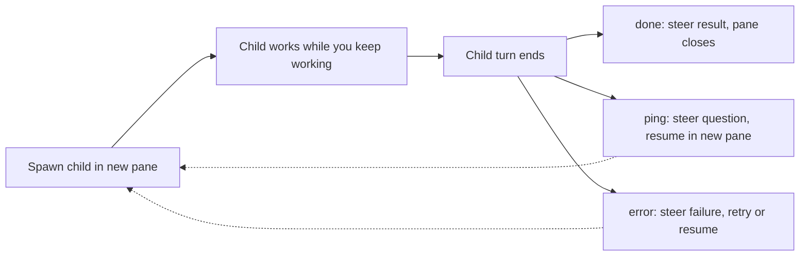

# pmux guide

This guide holds the full reference for pmux. For an overview and install steps, read the [README](../README.md).

## Contents

- [Environment](#environment)
- [Pane titles](#pane-titles)
- [Resume pi sessions](#resume-pi-sessions)
- [Live child status](#live-child-status)
- [Turn-end notification](#turn-end-notification)
- [tmux sidebar (pmux-explorer)](#tmux-sidebar-pmux-explorer)
- [External orchestrators (Claude Code)](#external-orchestrators-claude-code)
- [Async Subagent Flow](#async-subagent-flow)
  - [Decision model](#decision-model)
  - [In-progress status updates](#in-progress-status-updates)
    - [Configuration](#configuration)
- [Spawning Subagents](#spawning-subagents)
  - [Parameters (pmux_spawn)](#parameters)
- [Interrupting a running subagent](#interrupting-a-running-subagent)
- [Resuming a subagent](#resuming-a-subagent)
  - [Parameters (pmux_resume)](#parameters-1)
- [Messaging other agents](#messaging-other-agents)
- [caller_ping: child-to-parent help request](#caller_ping-child-to-parent-help-request)
- [Custom Agents](#custom-agents)
  - [Frontmatter Reference](#frontmatter-reference)
  - [`session-mode`](#session-mode)
  - [`surface`](#surface)
  - [`auto-exit` and the completion nudge](#auto-exit-and-the-completion-nudge)
  - [`interactive`](#interactive)
- [Tool Access Control](#tool-access-control)
  - [`spawning: false`](#spawning-false)
  - [`deny-tools`](#deny-tools)
  - [Recommended Configuration](#recommended-configuration)
- [Role Folders](#role-folders)
- [Tools Widget](#tools-widget)
- [Runtime notes](#runtime-notes)

## Environment

tmux is required. Run pi inside a tmux pane. Outside tmux the extension spawns nothing. It checks `TMUX` and `TMUX_PANE`, which tmux sets for every pane, and returns an error that names tmux when either is missing.

If shell startup is slow and the prompt drops subagent commands, set `PI_PMUX_SHELL_READY_DELAY_MS` to a higher value (default `500`):

```bash
export PI_PMUX_SHELL_READY_DELAY_MS=2500
```

Child panes open without stealing keyboard focus: a `pane` child splits a pane in the caller's window with tmux's detached split — pmux splits the caller's newest living child pane, or the caller's own pane when it has none, side by side when that pane is at least twice as wide as it is tall and stacked below otherwise — and a `tab` child opens a new window named after the subagent in the caller's session and then restores focus to the caller's window. Launch commands target child panes by explicit pane id. Focus and command delivery stay independent. The `interactive` option controls parent notifications. It does not control terminal focus.

## Pane titles

Each child pane is named at creation with `tmux select-pane -T <name>`, and the run wrapper writes an OSC 2 title of `<name> — <task>` shortly after the child boots. `<task>` is the first non-empty line of the task, truncated to 48 characters. With no task text, the title shows only the name. tmux shows the pane title on the pane border when `pane-border-status` is on. Parallel child panes stay easy to tell apart.

An unnamed pi pane that is not a subagent also gets a title from its first prompt. The extension sets the OSC title to `π - <prompt> - <cwd basename>`. `<prompt>` is the first non-empty line of the first user prompt, cut to 48 characters. Before the first prompt, pi's own title stays. The extension sets the title again on reload.

A pi session with a name keeps pi's own title `π - <name> - <cwd>`. The extension does not set a title for it. A subagent pane keeps `<name> — <task>`.

`tmux list-panes -a -F '#{pane_id} #{pane_title}'` prints the pane ids and titles. The extension itself resolves a pane name to its id with that listing.

---

## Resume pi sessions

The session file is the identity of a child. The pane is disposable; the session file stays on disk after the pane closes, and every follow-up runs from it.

A child that `pmux_spawn` started carries a launch record beside its session file, `<session>.launch.json`, which holds the role configuration resolved at spawn time. Continue the child with `pmux_resume` and the session file (see [Resuming a subagent](#resuming-a-subagent)). The resume restores the role configuration from the record and starts the child in a new tmux pane.

A session with no launch record, for example one that the `pmux` skill launched, also resumes through `pmux_resume`, as a plain pi session named `Resume`; its tool result says that the role configuration was not restored. When the session file is missing, the tool returns an error and starts no pane.

---

## Live child status

A child that runs this extension as a subagent publishes its live state as a status file next to its session file: `<session file>.status`. A pi pane that is not a subagent child writes no status file.

The file holds one JSON object with `status`, `at` (the ISO time of the write) and an optional `message`. The status is one of four values:

- `working` — a turn is running
- `idle` — the child finished a turn and waits for input
- `done` — the child ended through `pmux_done` (with or without a handoff) or through auto-exit
- `blocked` — the child asked for help with `caller_ping` (`message` holds the question), or its turn ended on a provider error (`message` holds the error text)

Each write replaces the whole file, so a reader never sees a partial object. A `done` or `blocked` write comes before the `.exit` sidecar write. A terminal write latches for the rest of the child process: later writes are skipped, and shutdown does not remove the file. A failed write never delays a turn, the sidecar write or shutdown.

A new run starts with no status. `pmux_spawn`, `pmux_resume`, and the skill's `start` and `resume` remove `<session file>.status` before the child starts, so the status of an earlier run is never read as the status of the new run. They remove `<session file>.exit` too, so the exit of an earlier run is never read as the exit of the new one.

A child that exits without completing is marked `blocked`. When the run wrapper sees the child exit, and the session has neither an `.exit` sidecar nor a terminal status, the wrapper writes `blocked` with a message that gives the exit code, and writes an `error` `.exit` sidecar that names the exit code and marks its source as the wrapper. The sidecar ends the parent's wait at once, so a crashed child does not leave the parent polling until the idle watchdog gives up. A clean completion or a ping is left as it is.

The CLI's `wait` command polls the file (see [External orchestrators (Claude Code)](#external-orchestrators-claude-code)). The widget's own labels (see [In-progress status updates](#in-progress-status-updates)) are a different, coarser view; only these four statuses appear in the status file.

---

## Turn-end notification

When a turn ends in a parent pi pane that does not have focus, the extension pushes one notification through tmux (`tmux display-message`), which shows in the tmux status line, so you do not have to visit every pane to learn that it waits for input. A normal turn sends `pi turn ended: <label>`. A turn whose last assistant message failed sends `pi turn failed: <label>`. An aborted turn sends nothing. tmux shows the text; a notification carries no level. The label is the session name, or the basename of the session cwd when the session has no name.

Subagent children send no notification: their completion already reaches the parent through the exit sidecar and `pmux_done`. Outside tmux the extension makes no notification call. The focus check reads `#{pane_active}` for the pane, and both the check and the push run in the background; a failed or slow tmux call results in no notification and never delays the next turn.

Set `notify.enabled` to `false` in `config.json` to turn these notifications off (see [Configuration](#configuration)).

---

## tmux sidebar (pmux-explorer)

If the [pmux-explorer](https://github.com/slatkin/pmux-explorer) sidebar is installed, the extension publishes the activity of every pi session it runs in to it, so a pi pane is listed with its status, its prompt, its last response and its tool activity — whether pmux started that session or not. A blocking extension prompt (for example a permission dialog) marks the pane as waiting for you.

The publishing is fire and forget: it never delays a turn, raises an error or writes to the session output. It needs the sidebar binary, looked up in this order: the `PMUX_EXPLORER_BIN` environment variable, `~/.tmux/plugins/pmux-explorer/bin/pmux-explorer`, `~/.tmux/plugins/pmux-explorer/target/release/pmux-explorer`, then `pmux-explorer` on `PATH`. When none is found, the session publishes nothing and stays quiet.

The pane's worktree comes from the sidebar's own window options, so a pi pane the sidebar spawned into a worktree shows the worktree and its branch.

Set `PMUX_EXPLORER=0` in the environment to turn the publishing off for a session that does have the sidebar.

When the pane's Tasks tab holds open items — recorded through the sidebar's `task-set` and `task-update` commands — a turn that ends while items are still open also receives the sidebar's update-before-finish reminder, one steer message at the turn's end. The reminder is buffered, so it does not fire turn after turn while the plan is being maintained: it stays silent until the store file has been untouched for five minutes and three turn ends have passed since its last write, and an injection resets both clocks. The reminder is the extension's own delivery and is not touched by that switch. The agent writes the per-pane store only through those commands; the extension only reads it. A failed or aborted turn gets nothing, a subagent child never gets the reminder, and a pane whose store holds nothing open is never nudged to record a list: an empty list stays silent at every boundary. The wording is not decided here; it is the constant `UPDATE_BEFORE_FINISH_REMINDER` from the sidebar repository's `src/task_reminders.rs`, quoted verbatim so both repositories carry the same reminder.

The package also ships the `sidebar-tasks` skill (`skills/sidebar-tasks`), the full instruction set for the task commands — recording with `task-set`, updating status with `task-update`, reading the store file, retiring an item — for every agent harness. pi sessions load it through the package manifest, and a parent pane's load installs the same skill for the agents outside pi: it copies the skill to `~/.agent/skills/sidebar-tasks` and points `~/.claude/skills/sidebar-tasks` at that copy, refreshing the copy whenever the packaged files change and leaving a real directory at the Claude location alone. The install is best effort and every failure is swallowed; a subagent child skips it, because a child is a pi session and gets the skill through the manifest.

The extension also writes the session's thinking feed, the file the sidebar's Thought tab reads. While a session runs in a tmux pane, each phase of a thinking block — its start, its streamed deltas coalesced to at most one append per 50 ms, and its end — is appended as one JSON record per line to `<dir>/<session id>.jsonl`, where `<dir>` is `$XDG_RUNTIME_DIR/pmux-thinking`, or `/tmp/pmux-thinking-<uid>` when `XDG_RUNTIME_DIR` is unset or empty. A new session id gets its own file and a resumed session appends to its own file. Reasoning text is the most sensitive stream, so the directory is created 0700 and the file 0600, and both modes are applied again each start, so a directory or file created first with another mode ends up private. The feed follows the sidebar switch — `PMUX_EXPLORER=0` turns it off — but not the binary lookup: it is written whether or not pmux-explorer is installed, and a feed that cannot be created or written never disturbs the session. The record contract — `{kind, ts, producer, text?}` with `kind` one of `start`, `delta`, `end` — is shared with the sidebar and documented in pmux-explorer's `docs/agent-protocol.md`.

---

## External orchestrators (Claude Code)

Install the `pmux` skill first (see the [README](../README.md#external-orchestrators-claude-code)).

The skill launcher `launch.ts` prepares everything outside the child pane. It finds the child extension, resolves the role, appends the parent-contact footer to the brief, splits and names a new pane, and writes the launch spec. A launch spec is a JSON file that starts one child. Run it with `node`:

```bash
node <skill-dir>/launch.ts start --name <child> --role <role> --cwd <dir> --brief <file> --parent <me> [--scratch <dir>] [--close-grace-ms <n>] [--report last|send] [--fallback]
```

On success it prints JSON with the pane id, the session file, and the launch-spec path. A follow-up always runs in a new pane from the same launch spec:

```bash
node <skill-dir>/launch.ts resume --launch <path> --prompt <file> [--name <child>]
```

The `--fallback` flag (no value) runs the child on the role's `model-fallback:` frontmatter value instead of its `model:`. Use it when the role's primary model hits API limits or errors, or when the user asks for the fallback or alternate model. The launch fails — naming the role and `model-fallback`, before any file is written or any pane is split — when the role sets no `model-fallback`. `resume` takes no `--fallback`: the launch record holds the model the start chose, and the follow-up runs on it. Nothing switches models automatically: nobody retries a child that failed on its model, so a re-launch with `--fallback` is the orchestrator's decision.

Placement has two sources: the role's `surface:` frontmatter applies when it names `pane`, `tab` or `float`, and then the extension's `config.json`. `pane` (default) places the child automatically in the caller's window: pmux splits the caller's newest living child pane, or the caller's own pane when it has none, side by side when that pane is at least twice as wide as it is tall and stacked below otherwise. `tab` opens its own workspace tab, and the window is named after the child so the tab is identifiable in the window list. `float` opens a floating pane in the caller's window, half the window's width and height, at the top right, while the caller keeps the focus (successive floats cascade down and left). On a resume, the role surface stored in the launch spec applies — a resume keeps the role's surface — and then the extension's `config.json`. On a `done` sidecar the child pane closes itself, split, tab or float.

For the report cross-check, run `node <skill-dir>/launch.ts last-message --session <file>`. It prints the last assistant message of the session, or `(no assistant message)`.

Completion signal: a child that finishes, pings, or errors writes its status to `<session>.status` before it exits — `done`, or `blocked` with the ping question or error text as the message. A user cancel (Escape) writes `done` with the message `cancelled`, and the child exits. In the default `last` mode, wait for the status with the CLI's `wait` command. Do not poll the pane:

```bash
node <skill-dir>/launch.ts wait --session <file> --status done,blocked --timeout <seconds>
```

The command polls the status file at a fixed interval; a missing file counts as no status yet. It exits 0 when the status matches, and prints the matched status line on stdout. It exits 2 when the timeout passes first, printing the last content it saw (or `{"status":null}` when there was none) on stdout and an error that names that status on stderr. It exits 1 on a usage error. `--status` is a comma-separated list of `working`, `idle`, `done` and `blocked`, and defaults to `done,blocked`; `--timeout` defaults to 600 seconds.

After the status wait, run the sidecar wait and act on the reason it prints; never read or delete the sidecar file yourself:

```bash
node <skill-dir>/launch.ts wait --session <file> --signal sidecar
```

The sidecar wait polls the `<session>.exit` file and never removes it — the run wrapper reads the same file after the child exits. It exits 0 when the sidecar appears, printing the decoded sidecar plus the sidecar's absolute path on one JSON line: `reason` is `done` (finished), `handoff` (handed off, with the continuation text as `handoff.message`), `ping` (the question as `ping.message`), `error`, or `cancelled` (the user stopped the child), with `errorSource` at `"wrapper"` when the wrapper wrote the sidecar. It exits 2 when the timeout passes first, printing `{"sidecar":null}` on stdout. The status file is the wake-up signal; the `.exit` sidecar stays the authoritative lifecycle record.

A `cancelled` sidecar means the user stopped the child with Escape. The child has exited, and no one is woken: in `send` mode the wrapper sends no wake-up. Do not resume or replace the child unless the user asks.

A child started with `--report send` is different: its `send` command writes the report to an immutable `<session>.<report-id>.report.md` file next to the session file before any pane call, and the orchestrator's pane receives a one-line pointer — the report ID, the file path, an embedded `node <cli> ack --session <file> --id <report-id>` command and a `[pmux-eom-…]` visibility token. The orchestrator reads the named file and then runs the embedded `ack` command; the ack record is the only read receipt, and only an unacknowledged report is re-delivered at the child's exit — same report ID, fresh token, one last pass that can itself fail to land in the pane. The line `send` prints in the child's own pane proves only that tmux accepted the pointer input, not that the text was consumed; the orchestrator's `ack` is the arrival proof. You still wait for the `.exit` sidecar with `node <skill-dir>/launch.ts wait --session <file> --signal sidecar [--timeout <seconds>]`. That mode is documented in the skill's "External orchestrators (Claude Code)" section (`skills/pmux/SKILL.md`).

Report transport: a marked pointer goes to the parent's inbox first. When the parent runs `node <skill-dir>/launch.ts inbox --follow` as a `Monitor` (the skill's "Inbox monitor" section), the pointer becomes an inbox entry and the monitor prints it; no channel request and no terminal input follow, and the `ack` stays the only read receipt. Without a running monitor the parent's channel endpoint comes next — the Unix socket owned by the parent pane's `pmux-explorer --mcp` process, available when the parent pane runs Claude Code started with `claude --dangerously-load-development-channels plugin:pmux-explorer@slatkin`. That channel is the legacy fallback; new setups start the monitor instead. On `emitted` the pointer reaches the parent's session as a channel event, with no terminal input, and it queues there while the parent is busy. On any transport failure — the endpoint is missing, refuses the connection, times out, is not armed yet, or replies with an error — the verified `send-keys` input runs as the fallback, and only then: a missing or late `ack` is never a transport failure, so a busy parent is never sent a second pointer. The `send` result line and the `notification` record carry `via` (`"inbox"`, `"channel"` or `"tmux"`) and, after a fallback, `inboxError` and `channelError`; a record without `via` reads as `"tmux"`. Exit codes do not change.

Close-on-done: after pi exits, the run wrapper closes its own pane only when the session `.exit` sidecar holds `done`, `handoff` or `cancelled`. It first waits a grace period of 5000 ms by default. Set it per launch with `start --close-grace-ms <n>`. `0` closes at once. The delay lets a blocked `wait` in the orchestrator observe the terminal status before the pane goes away. A provider error, a `caller_ping` or a crash leaves the pane open with the `__SUBAGENT_DONE_<n>__` sentinel visible when the child exited, so you can inspect the outcome. Close those panes yourself when done with them.

---

## Async Subagent Flow

```
1. Agent calls pmux_spawn()          → returns immediately ("started")
2. Sub-agent runs in a tmux pane   → widget shows live status
3. User keeps chatting             → main session fully interactive
4. Sub-agent finishes              → result steered back as a normal completion/failure
5. Main agent processes result     → continues with new context
```

Subagents run concurrently. Each result arrives independently when its child finishes.

```
╭─ Subagents ───────────────────────────────── 3 running ─╮
│ 01:23  Scout: Auth (scout)            active · write 7m │
│ 00:45  Researcher (researcher)               stalled 4m │
│ 00:12  Scout: DB (scout)                      starting… │
╰─────────────────────────────────────────────────────────╯
```

Completion messages render with a colored background and are expandable with `Ctrl+O` to show the full summary and session file path. The message names `pmux_resume` with the session file to continue the child.

### Decision model

Each child run has one of three outcomes: `done`, `ping`, or `error`. The `.exit` sidecar records the outcome. The orchestrator delivers it as a steer message. A user cancel (Escape) is not one of them: it ends the run quietly. The pane closes and the parent gets no message.



The sections below hold the details. Child exit rules live under `auto-exit` and the completion nudge. Parent backstop rules live under the idle watchdog. External orchestrator rules live in `skills/pmux/SKILL.md`. The normative spec is `openspec/specs/subagent-completion/spec.md`.

### In-progress status updates

The widget tracks each Pi-backed sub-agent from a child-written runtime snapshot and labels it with a coarse state:

- `starting` — launched, but no valid child snapshot has been observed yet
- `active` — the child is doing observed runtime work: agent turn, provider request, streaming, or tool execution
- `waiting` — the child finished a turn and is intentionally open for more input or another stage
- `stalled` — the parent has gone too long without a valid current child snapshot and can no longer trust the run is healthy
- `running` — fallback for backends without child snapshots (e.g. Claude)

Session-file growth does not drive these labels. Session JSONL still stores the transcript and still supports resume, lineage, and result extraction. Pi-backed liveness comes from a small activity snapshot. The child extension writes the snapshot. A fixed internal watchdog marks a run as `stalled` when valid snapshots never appear, stop being readable, or stop matching the current child. A long-running `active` or `waiting` state never becomes `stalled` from time alone. When a run enters `stalled` or recovers from it, the parent receives a steer message. All other transitions stay in the widget only.

Interactive subagents stay silent. A long-running user-driven child (for example a forked session with full conversation context) does not wake the parent on `stalled` or `recovered` transitions. The user works directly in the child pane. A steer message there burns an orchestrator turn on a no-op ping. The widget still updates normally. Snapshots are still recorded and classified under any `interactive` value. By default, agents with `auto-exit: true` are autonomous and get stall pings. Agents without it are interactive and stay quiet. Override per agent with `interactive: true|false` in frontmatter. Override per spawn with `interactive: true|false` on the tool call.

#### Configuration

The extension configuration controls the status display. It lives at `~/.pi/agent/extensions/pmux/config.json`, under `$PI_CODING_AGENT_DIR` when that variable is set. This location survives `pi update`. Seed the file from the shipped example:

```bash
mkdir -p ~/.pi/agent/extensions/pmux
cp config.json.example ~/.pi/agent/extensions/pmux/config.json
```

An older install may have left a `config.json` at the package root. Reads honor it when the new file is absent. The first `/pmux-surface` save writes the new location, seeded from the package-root file, which is left in place.

```json
{
  "status": {
    "enabled": true
  },
  "notify": {
    "enabled": true
  },
  "contextAlert": {
    "enabled": false,
    "threshold": 200000
  },
  "surface": "pane"
}
```

Git ignores `config.json`. Local overrides stay uncommitted.

`"contextAlert.enabled"` turns on the context alert. It defaults to `false`. When it is on, a child whose context usage reaches `"contextAlert.threshold"` gets a steer message that tells it to stop the task, commit the finished work or list the uncommitted changes, and end the session with `pmux_done` and a handoff. The threshold is a positive integer token count, or a percentage of the context window written as a string such as `"80%"`. It defaults to `200000` tokens.

`"notify.enabled"` controls the turn-end notification (see [Turn-end notification](#turn-end-notification)). It defaults to `true`. Set it to `false` if you do not need a status-line notification when an unfocused pane ends a turn.

`"surface"` controls where children open. The role's `surface:` frontmatter wins over this default. `"pane"` (default) places the child automatically in your window: pmux splits your newest living child pane, or your own pane when you have none, side by side when that pane is at least twice as wide as it is tall and stacked below otherwise. `"tab"` gives it its own workspace tab. The legacy values `"right"` and `"down"` are still accepted and mean `"pane"`. Change it live with `/pmux-surface pane|tab`.

---

## Spawning Subagents

```typescript
// Named agent with defaults from agent definition
pmux_spawn({ name: "Scout", agent: "scout", task: "Analyze the codebase..." });

// Force a full-context fork for this spawn
pmux_spawn({ name: "Fork", agent: "worker", fork: true, task: "Fix the bug where..." });

// Custom working directory
pmux_spawn({ name: "Designer", agent: "game-designer", cwd: "agents/game-designer", task: "..." });
```

### Parameters

| Parameter      | Type    | Default                 | Description                                                                                                                                                                                                                                                                                        |
| -------------- | ------- | ----------------------- | -------------------------------------------------------------------------------------------------------------------------------------------------------------------------------------------------------------------------------------------------------------------------------------------------- |
| `name`         | string  | required                | The display name. It appears in the widget and the pane title.                                                                                                                                                                                                                                     |
| `task`         | string  | required                | The task prompt for the child.                                                                                                                                                                                                                                                                     |
| `agent`        | string  | required                | It loads defaults from the agent definition. A name that resolves to no agent definition is an error, and the call starts no child; a role with no `model:` launches on pi's default model.                                                                                                        |
| `fork`         | boolean | `false`                 | It forces the full-context fork mode for this spawn. It overrides any agent `session-mode` frontmatter.                                                                                                                                                                                            |
| `interactive`  | boolean | derived                 | It marks this spawn as interactive (it does not wake the parent on stall or recovery). It defaults to the `interactive` frontmatter of the agent, otherwise to the inverse of `auto-exit`.                                                                                                         |
| `model`        | string  | —                       | It overrides the default model of the agent.                                                                                                                                                                                                                                                       |
| `fallback`     | boolean | `false`                 | It runs the child on the agent's `model-fallback`, not its `model`. Use it when the role's primary model hits API limits or errors, or the user asks for the fallback or alternate model. It fails before anything is written when the agent sets no `model-fallback`, or `model` is also set.     |
| `systemPrompt` | string  | —                       | It appends to the system prompt.                                                                                                                                                                                                                                                                   |
| `skills`       | string  | —                       | A comma-separated list of skill names.                                                                                                                                                                                                                                                             |
| `tools`        | string  | —                       | A comma-separated list of tool names.                                                                                                                                                                                                                                                              |
| `cwd`          | string  | —                       | The working directory for the child (see [Role Folders](#role-folders)).                                                                                                                                                                                                                           |

---

## Interrupting a running subagent

Use `pmux_interrupt` to cancel the active turn of a running Pi-backed subagent:

```typescript
pmux_interrupt({ id: "abcd1234" });
// or
pmux_interrupt({ name: "Scout" });
```

This sends Escape to the child pane and cancels the active model turn. The session stays alive. The pane, the session file, and the background polling all stay intact. After the interrupt, the widget moves the child back to `waiting` at once and ignores stale pre-interrupt snapshots. If the child starts work later, newer snapshots return it to `active`. Completion, failure, and `caller_ping` still flow normally. Before it sends Escape, the tool writes the `<session>.interrupt` marker, so the child knows the abort came from the parent and stays open. An Escape that the user presses in the pane has no marker: it stops the child, the pane closes, and the parent gets no message. This is a turn-level interrupt. It does not terminate a session.

> **Note:** It supports only Pi-backed children. A Claude-backed run returns an error.

---

## Resuming a subagent

`pmux_resume` starts a finished child in a new pane from its session file. It resumes pi children and Claude Code children. For a child that `pmux_spawn` started, the resume restores the role configuration from the spawn: the agent, the working directory, the model, the tool allowlist, the role prompt, the denied tools and the auto-exit value. The pane keeps the display name from the spawn.

`pmux_spawn` writes a launch record beside the child session file, `<session>.launch.json`. The record holds the values that the spawn resolved. A resume reads that record and does not read the agent file again. The resumed child therefore keeps the role configuration from spawn time even if the agent file changes later. The model follows the record too: a child that `pmux_spawn` started with `fallback: true` resumes on the fallback model the record holds, since the record carries one `model` value. `pmux_resume` takes no fallback parameter.

A Claude Code child has no pi session file. Its launch record stores the Claude Code session id when the run ends, and its result carries the child session path. `pmux_resume` starts Claude Code with `--resume <session id>` and `message` as the prompt. When the record has no stored session id, the tool returns an error and starts nothing.

A session with no launch record, for example one that the skill launched, resumes as a plain pi session named `Resume`. Its tool result says that the role configuration was not restored. When the session file is missing as well, the tool returns an error and starts no pane.

### Parameters

| Parameter     | Type    | Description                                                                                                                                                                                                                                                                                       |
| ------------- | ------- | ------------------------------------------------------------------------------------------------------------------------------------------------------------------------------------------------------------------------------------------------------------------------------------------------- |
| `sessionPath` | string  | Required. The child session file. For a Claude Code child, use the session path from its result.                                                                                                                                                                                                  |
| `message`     | string  | The follow-up prompt. With no message, the child resumes without a prompt.                                                                                                                                                                                                                        |
| `autoExit`    | boolean | Whether the resumed session auto-exits after its next response. When absent, the launch record's auto-exit and interactive values apply. `false` runs the resumed child interactively, so stall and recovery transitions do not wake the parent.                                                    |

The `name` parameter is removed: the resumed pane uses the name from the launch record, or `Resume` when there is no record. `pmux_spawn` also no longer takes `resumeSessionId`; use `pmux_resume` with the session file.

---

## Messaging other agents

Use `pmux_message` to pass text to another agent in the same tree. Everyone keeps working:

```typescript
pmux_message({ to: "parent", message: "Which DB driver should I use?" });
pmux_message({ to: "Reviewer", message: "API is in src/api.ts" });
```

Reachable agent targets: exactly these three by name, nothing else:

- `parent` — the agent that spawned you (subagents only, and only when that parent is a pi session)
- the display name or id of one of your own running children
- the display name or id of a running sibling (another running child of your parent)

Grandchildren, grandparents, finished children, and unrelated agents are not reachable *by name*. If you message a finished child, the tool returns an error that lists the reachable targets. Use `pmux_resume` for a finished session. If a name is ambiguous, pass the exact subagent id.

Beyond agent names, `to` also accepts a raw tmux pane — for panes outside the agent tree, such as another pi session or a Claude Code pane. The forms, tried in order: a `%N` pane id, tmux target syntax (`session:window.pane`, `window.pane`, `window`, a pane index, or an `@N` window id — session-less forms resolve inside your own session), then an exact pane title. A pane id that belongs to a managed child or sibling still resolves to that agent. A title matching several panes returns an error listing the pane ids. One refusal: a pane running a bare shell is never typed into, because there the message would execute as a command — that covers foreign panes and managed panes that dropped back to a shell.

`parent` is reachable only when a pi parent exists. A child that the pmux skill launcher started for an external orchestrator (Claude Code) carries `PI_PMUX_EXTERNAL_PARENT` in its env: no pi parent reads its message file, so `parent` is not in its reachable-target list, and nothing is delivered. Sending to `parent` returns an error that says the parent is an external orchestrator that does not read subagent messages, tells the child to report the way the parent-contact footer at the end of its brief says, and names `caller_ping` as the way to ask a question. A child of a pi parent still reaches `parent` as before.

Delivery uses two paths. Messages to children and siblings are typed into the target's tmux pane as literal input (`tmux send-keys -l`), followed by an Enter keypress. They appear in the target pane as input with a sender header (for example `[subagent message from Worker (sibling)]`). tmux cannot tell whether the target is ready for input, so the text is typed as it is: a target on an approval screen receives it as typed input. Messages to `parent` append to the child message file when a pi parent exists. The parent injects them as a steering message. They never touch a draft that the user types in the parent composer.

Delivery is asynchronous. The tool returns when the message is queued. Any reply arrives later as a separate message. If tmux returns an error, such as an unknown or closed pane, the tool returns an error that names the target and holds the tmux error text. It never retries automatically.

These tools differ. `caller_ping` and `pmux_done` end the sending session. `pmux_message` does not end it.

> **Note:** Claude Code children can receive messages. They have no `pmux_message` sending tool.

---

## caller_ping: child-to-parent help request

The `caller_ping` tool lets a child request help from its parent. When the child calls it, the child session exits and the parent receives a notification with the help message. The parent then resumes the child session with a response through `pmux_resume`.

`caller_ping` takes one parameter: `message` (required) holds the help text.

`pmux_resume` takes the child `sessionPath` (required) and an optional `message`. It restores the role configuration from the launch record. Read [Resuming a subagent](#resuming-a-subagent) for all parameters.

Interaction flow:
1. The child calls `caller_ping({ message: "Not sure which schema to use" })`.
2. The child session exits (like `pmux_done`).
3. The parent receives a steer notification: *"Sub-agent Worker needs help: Not sure which schema to use"*.
4. The parent resumes the child session through `pmux_resume` with the response.
5. The child picks up where it left off with the guidance of the parent.

Example:
```typescript
// Inside a worker subagent
await caller_ping({
  message: "Found two conflicting migration files — should I use v1 or v2?"
});
// Session exits here. Parent receives the ping, then resumes this session
// with guidance like "Use v2, v1 is deprecated"
```

> **Note:** Call `caller_ping` only inside a child. A standalone pi session returns an error.

---

## Custom Agents

To add a custom agent, place a `.md` file in `.pi/agents/` (project) or `~/.pi/agent/agents/` (global):

```markdown
---
name: my-agent
description: Does something specific
model: openrouter/z-ai/glm-5.3-flash
thinking: minimal
tools: read, bash, edit, write
session-mode: lineage-only
spawning: false
---

# My Agent

You are a specialized agent that does X...
```

### Frontmatter Reference

| Field                      | Type    | Description                                                                                                                                                                                                                                                                                                                                |
| -------------------------- | ------- | ------------------------------------------------------------------------------------------------------------------------------------------------------------------------------------------------------------------------------------------------------------------------------------------------------------------------------------------ |
| `name`                     | string  | The agent name. Use it in `agent: "my-agent"`.                                                                                                                                                                                                                                                                                             |
| `description`              | string  | It appears in `pmux_list` output.                                                                                                                                                                                                                                                                                                     |
| `model`                    | string  | The default model (for example `openrouter/z-ai/glm-5.3-flash`).                                                                                                                                                                                                                                                                             |
| `model-fallback`           | string  | The alternate model. Only a launch that asks for the fallback uses it (`fallback: true` on `pmux_spawn`, `--fallback` on the skill launcher). A blank value counts as absent, and pmux checks nothing about the name.                                                                                                                      |
| `thinking`                 | string  | Thinking level: `minimal`, `medium`, `high`.                                                                                                                                                                                                                                                                                               |
| `tools`                    | string  | Native pi tools only, as a comma-separated list: `read`, `bash`, `edit`, `write`, `grep`, `find`, `ls`.                                                                                                                                                                                                                                    |
| `skills`                   | string  | A comma-separated list of skill names to auto-load.                                                                                                                                                                                                                                                                                        |
| `session-mode`             | string  | The default child-session mode: `standalone`, `lineage-only`, or `fork`.                                                                                                                                                                                                                                                                   |
| `surface`                  | string  | The default surface for this agent's spawns: `pane`, `tab`, or `float`. An invalid value is ignored, and the agent then has no surface preference.                                                                                                                                                                                         |
| `spawning`                 | boolean | Set `false` to deny all child-spawning tools.                                                                                                                                                                                                                                                                                              |
| `deny-tools`               | string  | A comma-separated list of extension tool names to deny.                                                                                                                                                                                                                                                                                    |
| `auto-exit`                | boolean | Auto-shutdown when the agent finishes its turn, with no `pmux_done` call. If the user sends any input, auto-exit is disabled permanently and the user takes over the session. Use it for autonomous agents (scout, worker). Do not use it for interactive ones. It also sets the default value of `interactive` (see below). |
| `interactive`              | boolean | Default: derived. It overrides whether stall and recovery transitions wake the parent session. It defaults to the inverse of `auto-exit`. Autonomous agents (`auto-exit: true`) are non-interactive and get stall pings. Agents without `auto-exit` are interactive and stay quiet. Explicit values take precedence.                       |
| `cwd`                      | string  | The default working directory (absolute or relative to project root).                                                                                                                                                                                                                                                                      |
| `disable-model-invocation` | boolean | It hides this agent from discovery surfaces like `pmux_list`. The agent stays directly invocable by explicit name through `pmux_spawn({ agent: "name", ... })`.                                                                                                                                                                         |

---

Discovery still resolves precedence before visibility filtering. If a project-local hidden agent has the same name as a visible global or bundled agent, the hidden project agent wins. The lower-precedence agent does not appear in `pmux_list`.

### `session-mode`

Choose how a child session starts:

- `standalone`: Default. A fresh session with no lineage link to the caller.
- `lineage-only`: A fresh blank child session with `parentSession` linkage and no copied turns from the caller.
- `fork`: A linked child session seeded with the prior conversation context of the caller.

`lineage-only` fits when session discovery and fork lineage UX must show the relationship later, but the child must not inherit the turns of the parent.

`fork: true` on the tool call always forces `fork` mode for that spawn.

```yaml
---
name: my-agent
session-mode: lineage-only
---
```

### `surface`

Set where the spawns of this agent open: `pane` (a pane placed automatically in the caller's window), `tab` (its own workspace tab), or `float` (a floating pane in the caller's window, half the window's width and height, at the top right, with the focus staying on the caller; successive pmux floats cascade down and left).

The role's `surface:` wins over the configured default. An invalid value is ignored, and the agent then has no surface preference.

A resume keeps the role's surface: the launch record (pi parent) and the launch spec (external orchestrator) store the role's surface, and a resume uses it.

`float` is never a default: `config.json` and `/pmux-surface` accept only `pane` and `tab`.

```yaml
---
name: reviewer
surface: float
---
```

### `auto-exit` and the completion nudge

Agents with `auto-exit: true` exit themselves. When the agent finishes a turn normally and the user has not taken over the pane, the child writes the `done` `.exit` sidecar and the session ends, with no `pmux_done` call. The last assistant message becomes the result for the parent. A user Escape writes the `cancelled` `.exit` sidecar and ends the session, and the parent gets no message. Error stops still exit at once with the error sidecar reported to the parent. An aborted turn schedules no nudge.

If the user types into an auto-exit agent pane after its first run, the session becomes user-owned. Auto-exit is disabled from that point. The nudge below takes over.

All other sessions exit through an explicit tool call: `pmux_done` to finish, or `caller_ping` to hand a question back to the parent. To make that reliable, the child extension nudges itself. When the agent finishes a turn normally without calling `pmux_done`, it receives a follow-up reminder after 5 seconds:

> [Automated reminder] Your last turn ended but this session is still open.
> If your task is complete, call the pmux_done tool now, with no other text — your last message was already delivered as your report, do not repeat or summarise it.
> If you are blocked, call caller_ping with your question. Otherwise, continue working.

These events cancel a pending nudge: the agent starts new work, the user types into the pane, or the agent calls `pmux_done` or `caller_ping`. Error stops never nudge. They still exit at once and report the failure to the parent.

Configure the nudge with environment variables (read by the child at launch):

| Variable                     | Default | Purpose                                  |
| ---------------------------- | ------- | ---------------------------------------- |
| `PI_PMUX_NUDGE_DELAY_MS` | `5000`  | Delay before the reminder (minimum 1000) |
| `PI_PMUX_NUDGE_DISABLE`  | unset   | Set to `1` to disable the nudge entirely |

Parent-side idle watchdog. The child nudge depends on the child and the model, so the parent backs it up. For non-interactive children, if the child activity file has said `waiting` (turn ended) for 30 seconds without the session exiting, the parent types a reminder into the pane itself — the same reminder text, which lives in `pi-extension/pmux/nudge.ts` so the two copies cannot drift apart. After two such reminders, if the child still waits another 30 seconds, the parent finishes it as if `pmux_done` had been called. The last assistant message becomes the result, and the pane closes. The parent never touches interactive children. The timings live in `pi-extension/pmux/idle-watchdog.ts`.

What `auto-exit: true` does: it ends the session when the turn of the agent completes normally (see above), and it shapes defaults:

- The task hint tells the agent upfront to call `pmux_done` when finished ("Complete your task autonomously, then call pmux_done.").
- It sets the default for `interactive` (see below). `auto-exit: true` agents count as autonomous and get stall pings. Agents without it count as interactive and stay quiet.

```yaml
---
name: scout
auto-exit: true
---
```

### `interactive`

It controls whether status transitions (`stalled`, `recovered`) wake the parent session with a steer message.

Default: the inverse of `auto-exit`. Autonomous agents (`auto-exit: true`) are non-interactive and ping the parent on stall and recovery. Agents without `auto-exit` are interactive and stay quiet. A role whose definition sets no `interactive` or `auto-exit` (for example a plain role with `fork: true`) counts as interactive.

Why it exists: interactive agents can run for minutes or hours while the user thinks, types, and reads in the child pane. Child snapshots still update the widget. Stalled and recovered supervision messages rarely need to wake the parent for user-driven sessions. Skipped steers keep the parent quiet until the child actually finishes.

When to override:

- Set `interactive: false` on an agent without auto-exit when you still want stall pings.
- Set `interactive: true` on an autonomous agent when you prefer to check on it yourself.

```yaml
---
name: my-agent
# interactive defaults to true because auto-exit is not set
---
```

Or per spawn:

```typescript
pmux_spawn({ name: "Scout", agent: "scout", interactive: true, task: "..." });
```

---

## Tool Access Control

By default, every child can spawn further children. Control this behavior with frontmatter:

### `spawning: false`

It denies all child lifecycle tools (`pmux_spawn`, `pmux_interrupt`, `pmux_list`, `pmux_resume`):

```yaml
---
name: worker
spawning: false
---
```

### `deny-tools`

For control over individual extension tools:

```yaml
---
name: focused-agent
deny-tools: subagent
---
```

### Recommended Configuration

| Agent      | `spawning`  | Rationale                            |
| ---------- | ----------- | ------------------------------------ |
| worker     | `false`     | Implements tasks, does not delegate. |
| researcher | `false`     | Researches, does not spawn.          |
| reviewer   | `false`     | Reviews, does not spawn.             |
| scout      | `false`     | Gathers context, does not spawn.     |

---

## Role Folders

The `cwd` parameter starts a child in a specific directory with its own configuration:

```text
project/
├── agents/
│   ├── game-designer/
│   │   └── CLAUDE.md          ← "You are a game designer..."
│   ├── sre/
│   │   ├── CLAUDE.md          ← "You are an SRE specialist..."
│   │   └── .pi/skills/        ← SRE-specific skills
│   └── narrative/
│       └── CLAUDE.md          ← "You are a narrative designer..."
```

```typescript
pmux_spawn({ name: "Game Designer", agent: "game-designer", cwd: "agents/game-designer", task: "Design the combat system" });
pmux_spawn({ name: "SRE", agent: "sre", cwd: "agents/sre", task: "Review deployment pipeline" });
```

To set a default `cwd`, put it in the agent frontmatter:

```yaml
---
name: game-designer
cwd: ./agents/game-designer
spawning: false
---
```

---

## Tools Widget

Every child session shows a compact tools widget with available and denied tools. Toggle it with `Ctrl+H`:

```text
[scout] — 12 tools · 4 denied  (Ctrl+H)              ← collapsed
[scout] — 12 available  (Ctrl+H to collapse)          ← expanded
  read, bash, edit, write, todo, ...
  denied: subagent, pmux_list, ...
```

---

## Runtime notes

No Unix shell is needed at runtime. Every child spawns with argument arrays. The pane command line is a single `node` command that tmux sends to the pane. The package ships no shell scripts.
